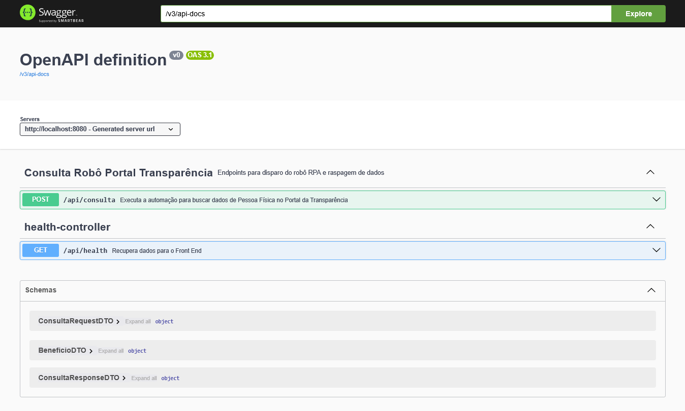
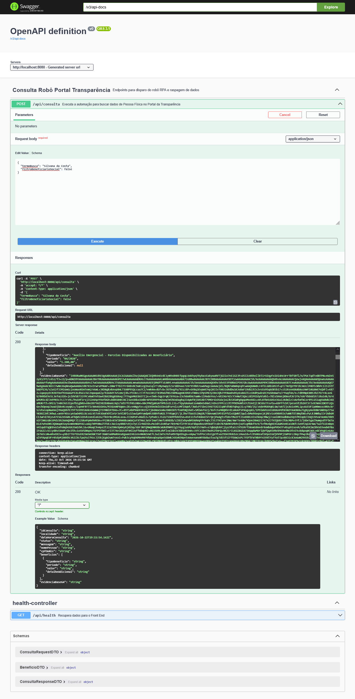
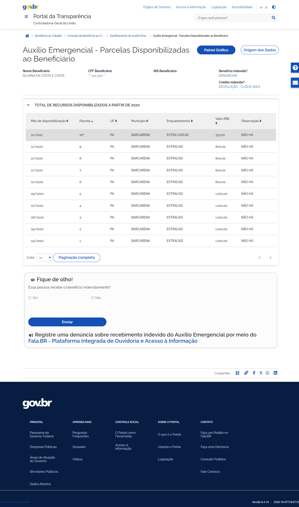
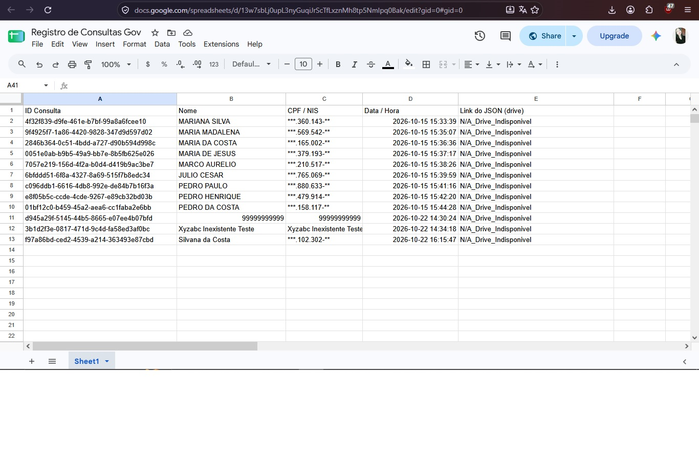

# 🤖 Robô de Automação e Consulta – Portal da Transparência

API REST desenvolvida em Spring Boot integrada com automação web via Playwright, com persistência automatizada de evidências visuais no Google Drive e relatórios de auditoria em tempo real no Google Sheets.

## 🚀 Tecnologias Utilizadas

  Java 17+ / Spring Boot 3 (Arquitetura REST, Injeção de Dependências e robustez corporativa).

  Microsoft Playwright for Java (Automação web de alta performance, manipulação headless/headed e captura nativa de telas).

  Google APIs (Drive & Sheets) (Integração via Service Account para armazenamento de payloads JSON e registro de auditoria).

  Lombok (Redução de boilerplate no mapeamento de DTOs).

  Springdoc OpenAPI / Swagger UI (Documentação interativa dos endpoints).

## ⚙️ Arquitetura e Decisões Técnicas

  Escolha do Playwright vs. Selenium: Optou-se pelo Playwright devido à sua alta velocidade de execução, suporte nativo a múltiplos contextos e robustez na espera automática de elementos assíncronos do DOM, o que evita falhas comuns de sincronização em portais governamentais pesados.

  Resiliência e Tratamento de Erros: A aplicação isola as chamadas de serviços externos (Google Drive e Google Sheets) em blocos de exceção dedicados. Caso ocorra instabilidade ou limite de cota em serviços de terceiros, o fluxo principal do robô e a resposta ao cliente nunca são interrompidos.

  Mapeamento de Cenários Específicos: O robô identifica nativamente quando uma busca retorna vazia ou quando um CPF/NIS/Nome não é localizado, injetando as mensagens exatas exigidas pelo contrato de negócio e capturando a evidência visual da tela de erro em formato Base64.

  Gerenciamento de Concorrência: O serviço de raspagem implementa controle de acesso thread-safe (synchronized), garantindo estabilidade total ao processar chamadas concorrentes sem colisão de frames do navegador.

## 📋 Pré-requisitos

  Java JDK 17 ou superior instalado.

  Maven configurado.

  Uma conta de serviço do Google Cloud com acesso às APIs do Google Drive e Google Sheets (com o arquivo credentials.json posicionado localmente na sua máquina).

## 🔧 Configuração e Execução

1. Clone o repositório:
Bash
  ```
  git clone https://github.com/Nicolly95/Hiperautomocao.git
  cd transparencia-bot
  ```

2. Configure as Credenciais do Google:
Certifique-se de que o seu arquivo de credenciais da Service Account está configurado no projeto (o arquivo está ignorado pelo Git por segurança).

3. Execute a aplicação via Maven:
Bash
  ```
  mvn spring-boot:run
  ```

4. Acesse o Swagger UI:
Abra no seu navegador o endereço:http://localhost:8080/swagger-ui/index.html


## 🧪 Endpoints da API
POST /api/consulta

Realiza a consulta de um cidadão ou benefício no Portal da Transparência.

  * Payload de Exemplo (Sucesso por Nome):
  JSON
  {
    "termoBusca": "MARIANA SILVA"
  }

  * Payload de Exemplo (Cenário de Erro - CPF Inexistente):
  JSON  
  {
    "termoBusca": "999.999.999-99"
  }

## 📊 Auditoria Automatizada

Cada execução bem-sucedida ou tentativa de erro gera automaticamente:

  * Um registro na Planilha do Google Sheets contendo ID único, termo buscado, dados coletados, data/hora e link do JSON no Google Drive.
  * Uma captura de tela completa da página (evidenciaBase64) para fins de auditoria e conformidade.

## 📸 Demonstração da Solução

### Swagger UI Documentação


### Swagger UI Requisição


### Evidência em base64


### Auditoria no Google Sheets
